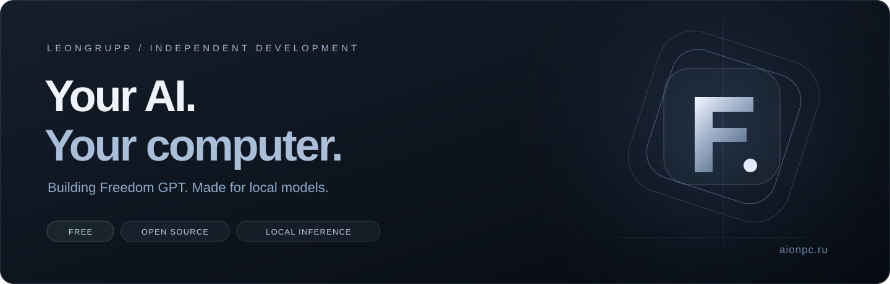

# Leongrupp

**Создаю практичные инструменты для локального ИИ и независимых проектов.**

[Сайт](https://aionpc.ru/) · [Freedom GPT](https://github.com/Leongrupp/freedom-gpt) · [Скачать](https://github.com/Leongrupp/freedom-gpt/releases/latest) · [English](README.md) · [Telegram @AI1rus](https://t.me/AI1rus)

## Главный проект — Freedom GPT

Бесплатное приложение с открытым исходным кодом для запуска совместимых моделей на вашем компьютере. Локальные чаты, код, файлы, история проектов и отдельные модели для изображений.

| Возможность | Что это значит |
| :--- | :--- |
| **Без подписки для локальных запросов** | Нет оплаты за токены со стороны Freedom GPT и обязательного платного API. Нужны ваше железо, электричество и диск. |
| **Выбор моделей** | Проверка ПК, поиск моделей, возобновляемые загрузки и SHA256. |
| **Продолжение работы над проектами** | Сохранённые диалоги, файлы и заметки на вашем диске. |
| **Локальное творчество** | Отдельный комплект для изображений. Видеостудия экспериментальная. |
| **Открытое развитие** | Исходники MIT, русский и английский интерфейс, публичные релизы и известные ограничения. |

## С чего начать

- [Windows 10/11 x64](https://aionpc.ru/install/windows/) — EXE или переносимый ZIP, Python и движки уже внутри.
- [Ubuntu 24.04 x64](https://aionpc.ru/install/ubuntu/) — .run, DEB или TAR.GZ.
- [macOS, тестовая сборка Apple Silicon](https://aionpc.ru/install/macos/) — M1+, macOS 26.2+, без подписи. Запуск на настоящем Mac ещё не проверен.

После скачивания локальные модели могут работать без интернета. Сайты, поиск, загрузки и обновления требуют сети. У моделей отдельные лицензии; скорость и качество зависят от выбранной модели и ПК. Проект не открывает бесплатный доступ к закрытым облачным моделям.

[Инструкция установки](https://github.com/Leongrupp/freedom-gpt/blob/main/INSTALL.ru.md) · [Выбор модели по памяти](https://aionpc.ru/guides/choose-model/) · [Проверки и ограничения](https://github.com/Leongrupp/freedom-gpt/blob/main/VERIFICATION.md)

## Что развиваю дальше

Удобную установку, рабочие сценарии агента, совместимость моделей, доступный интерфейс и локальные творческие инструменты. Проверка Mac и поддержка видео на разных ПК продолжаются.

**Технологии:** Python, JavaScript, локальные API моделей, GGUF / llama.cpp, CUDA и Metal там, где они поддерживаются.

## Как помочь

Проверьте приложение на своём ПК, расскажите о результате, предложите улучшение перевода или отправьте небольшой исправляющий PR. Для отчёта полезны ОС, CPU/RAM/GPU, модель и шаги повторения ошибки. Не публикуйте ключи и личные данные из журналов.

[Сообщить об ошибке](https://github.com/Leongrupp/freedom-gpt/issues/new/choose) · [Обсудить идею](https://github.com/Leongrupp/freedom-gpt/discussions) · [Связаться в Telegram](https://t.me/AI1rus)

Если проект полезен, поддержите его настоящей звездой или поделитесь ссылкой. Спасибо за отзывы и участие 💛

[Добровольная поддержка разработки](https://github.com/Leongrupp/freedom-gpt#support-development). Приложение бесплатно для скачивания и использования.
